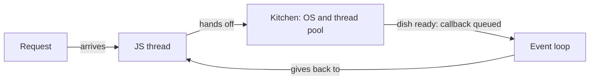

# Example: first document for "Node.js single thread"

This is what a first document looks like when every rule is applied. Use it as a reference for shape and length, not as a template to copy word for word.

---

**Node runs your JavaScript on a single thread, and hands all the slow work to someone else.**

## What this is about

- **What:** the Node.js execution model. One single thread runs your code. A **thread** is a line of instructions the processor runs one after the other.
- **Why it matters:** one greedy function is enough to freeze your whole server, along with every request in progress.
- **Who decides:** Node manages the thread and the loop that feeds it, the **event loop**. You decide what you give it to run.

## Your code goes through a single waiter

**Only one line of your JS runs at any given moment.**

Picture a restaurant with a single waiter. They take an order, pass it to the kitchen and move on to the next table without waiting for the dish. One waiter still serves the whole room, as long as they don't get stuck at one table.

## Slow work goes to the kitchen

**Network, disk and crypto do not go through your thread.**

- **The network** (HTTP, database) is handled by the operating system.
- **Files, DNS and crypto** go to the **thread pool**, a kitchen crew of 4 threads by default.

So "single thread" only applies to your JS. Node itself uses several threads behind the scenes.

**A finished dish waits until the waiter's hands are free.**

The diagram does not show the priority order between waiting callbacks. Some jump the queue, and that is a topic of its own.

## A long computation blocks the whole room

**While your thread computes, no other request moves.**

If the waiter starts peeling potatoes themselves, nobody gets served. In Node, that is a big `JSON.parse`, a loop over hundreds of thousands of items, or an `fs.readFileSync`.

## In one sentence

One waiter for your code, a kitchen for the slow work, and the whole room waits as soon as the waiter starts cooking.

---

**Go further**

🟢 easy · 🟡 intermediate · 🔴 advanced

- [x] **1. Overview**: one thread for JS, slow work handed off, blocking 🟢
- [ ] **2. What actually blocks**: which functions and patterns freeze the server? 🟢
- [ ] **3. The `await` trap**: why can an `async` function still block everything? 🟢
- [ ] **4. Execution order**: who goes first between Promise, `nextTick` and `setTimeout`? 🟡
- [ ] **5. Worker threads**: how do you move a heavy computation off the main thread? 🟡
- [ ] **6. Configuring the thread pool**: where and how do you add cooks? 🟡
- [ ] **7. Diagnosing a block**: how do you measure event loop delay and find the culprit? 🟡
- [ ] **8. Several processes**: `cluster` and PM2 to use every core of the machine 🔴
- [ ] **9. The starved loop**: how can microtasks stop I/O from getting through? 🔴

Reply with a number (or several).

---

Sources: official Node.js documentation (event loop, libuv thread pool).
